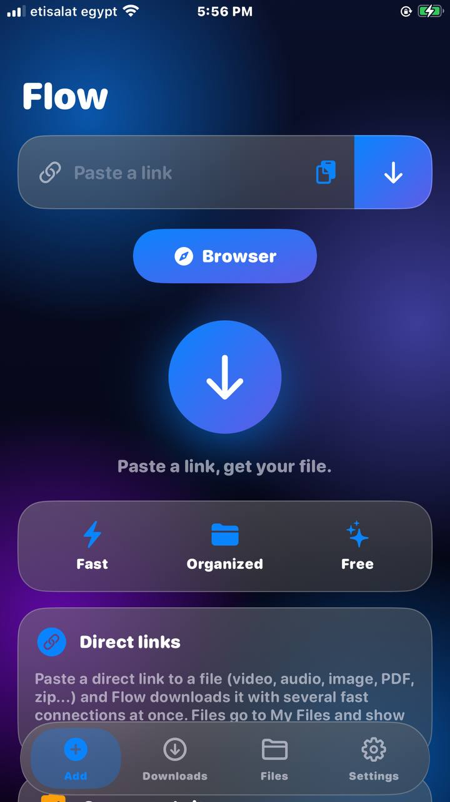
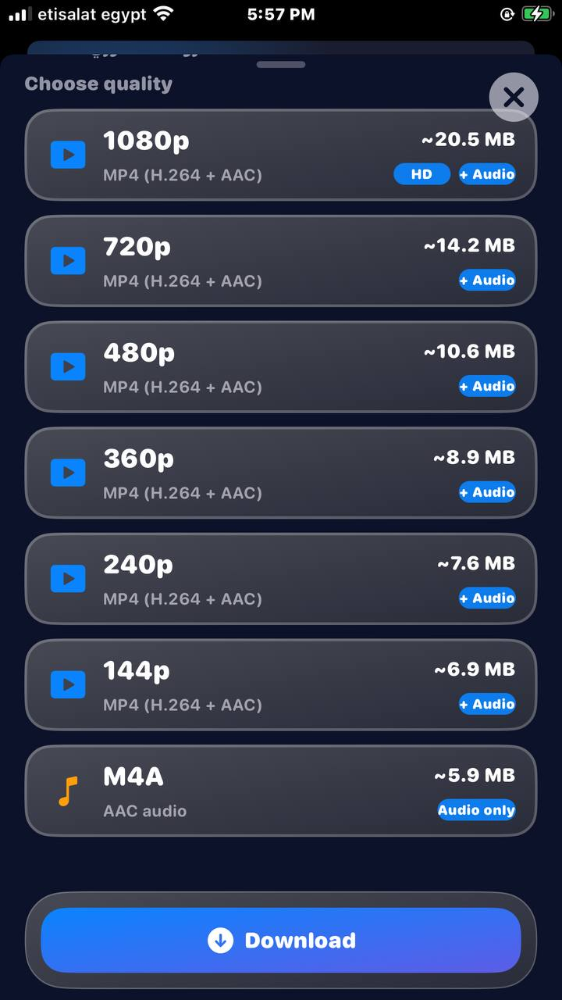
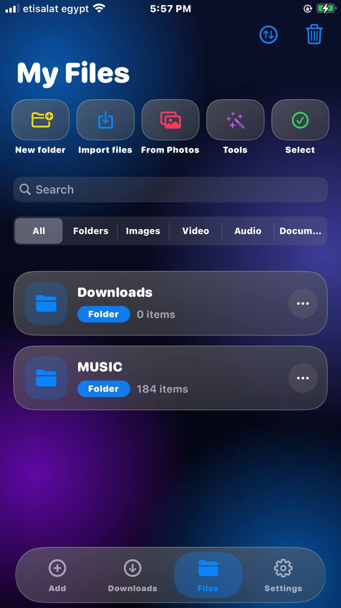
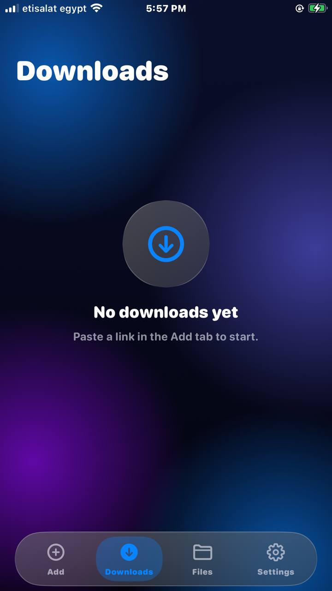
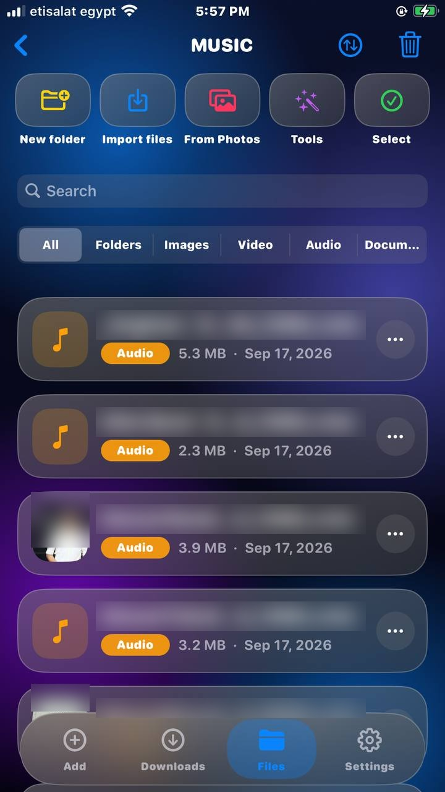
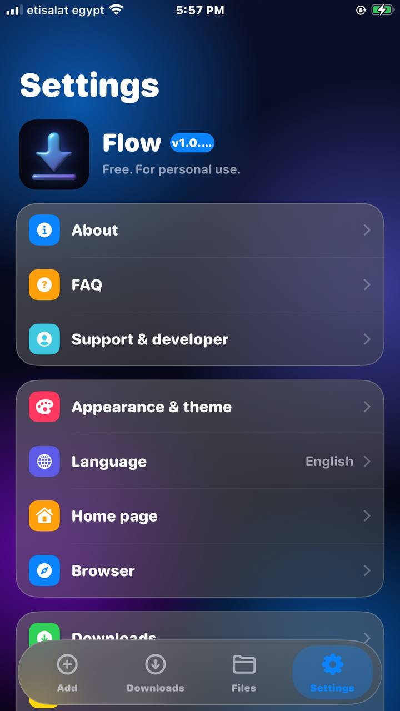
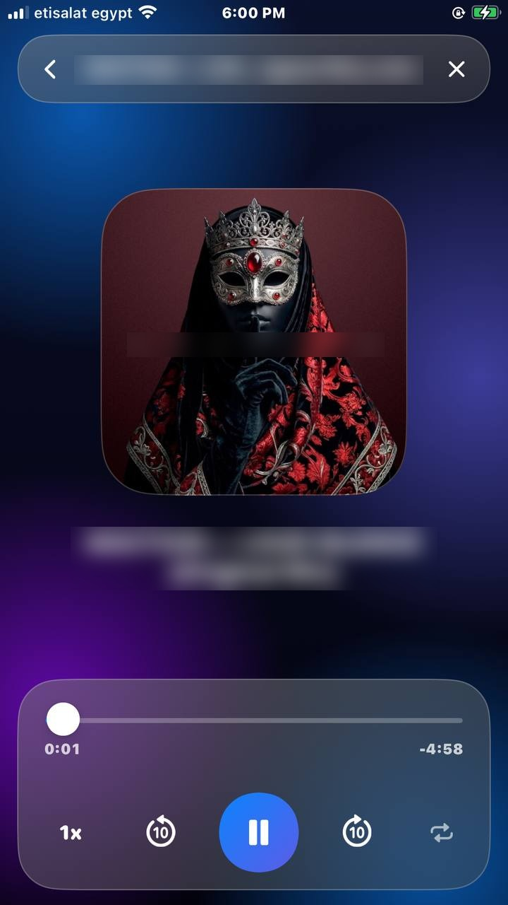
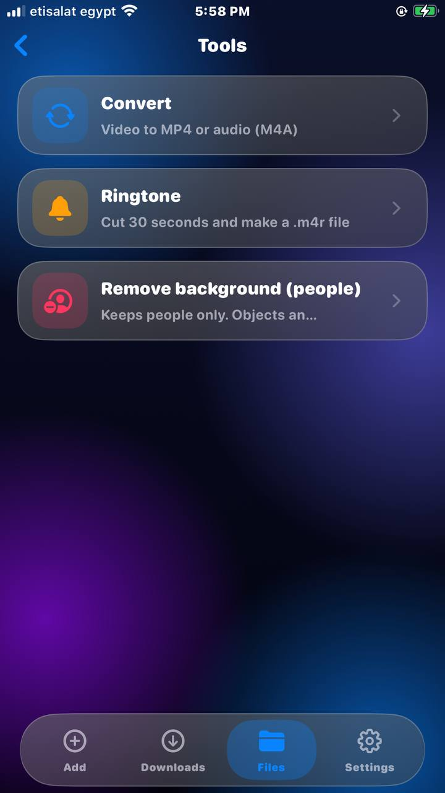

# Flow

Flow is a free media and file downloader for iPhone (iOS 15+), made for personal use. Paste a link, pick a quality, and the file lands in a built-in file manager with a player.

  
  
  

## Features

- Extractors for public videos from YouTube, TikTok, Facebook, Instagram and X
- Quality picker (up to 1080p MP4, or audio only as M4A)
- Fast multi-connection downloads, plus direct links to any file (video, audio, image, PDF, zip)
- File manager with folders, import, search, sort, and a Trash with restore
- Player with background audio and a mini player
- Cover art fetch for audio files
- Tools: convert (video to MP4 or M4A), ringtone maker (30 s `.m4r`), background removal for people photos
- Auto-updating extractors, so site fixes arrive without a new app build
- English and Egyptian Arabic, colour themes, pure black mode

## Screenshots

| | | |
|---|---|---|
|  Add |  Quality picker |  Downloads |
|  My Files |  Folder with cover art |  Settings |
|  Player |  Tools | |

## Install

**iPhone (iOS 15+)**

1. Download the `.ipa` from the [latest iPhone release](https://github.com/Jo0sef/Flow/releases/tag/v1.0.28).
2. Sideload it with [3uTools](https://www.3u.com/) or a similar tool (Sideloadly, AltStore) and a free Apple ID.
3. A free Apple ID signs the app for 7 days. After that it stops opening and you need to sign it again with the same tool. Your downloaded files stay on the device.
4. Flow shows a notice when a newer version is out. iOS cannot install updates by itself, so the notice opens the release page.

**Android**

1. Download the `.apk` from the [latest Android release](https://github.com/Jo0sef/Flow/releases/tag/v1.5.6).
2. Open it and allow "install unknown apps" if Android asks.
3. Later updates: Settings > About > Check for app update.

## Updatable extractors

Site-specific logic lives in `extractors.js`. The app checks for a newer copy when it opens and once a day (Settings > Downloads > Extractors), from:

1. `https://raw.githubusercontent.com/Jo0sef/Flow/main/extractors.js`
2. `https://cdn.jsdelivr.net/gh/Jo0sef/Flow@main/extractors.js`
3. `https://jo0sef.github.io/Flow/extractors.js`

A new file is installed only if it parses, defines `flowExtract`, has a higher `FLOW_VERSION`, passes a short self-test, and does not need a newer app. The previous copy is kept and restored if the new one fails.

## Build from source

Source is in [`source/`](source). `build.sh` compiles `main.m` (the `p*.m` parts joined together) with clang and the iPhoneOS SDK. Put the binary, `Info.plist`, `extractors.js` and the icons in `Payload/Flow.app/`, zip `Payload` as an `.ipa`, then sign it with your Apple ID.

## Disclaimer

Flow is for personal use only. You are responsible for following the terms of the sites you use and for respecting copyright. Download only public content that you own or have permission to download. Flow does not bypass logins, paywalls or DRM, and it is not affiliated with YouTube, TikTok, Facebook, Instagram, X or any other site.
